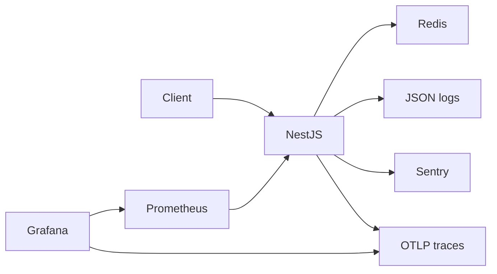

# NestJS Observability Stack

[](https://github.com/yashybm30/nestjs-observability-stack/actions/workflows/ci.yml)

An instrumented API with a local metrics, dashboard and tracing environment.

## Implemented features

- HTTP request/error counters, work latency histograms and process CPU/memory metrics
- Structured JSON request logs with correlation IDs
- OpenTelemetry HTTP/Redis auto-instrumentation and OTLP export to Jaeger
- Provisioned Grafana dashboard and Prometheus availability/latency alerts
- Optional Sentry capture of unhandled application exceptions

## Architecture



Stack: NestJS, OpenTelemetry, Prometheus, Grafana, Jaeger, Sentry, Redis.

## Local setup

Requirements: Node.js 24, npm, Docker Engine with Compose v2. The HA cluster experiments additionally require kind, kubectl, metrics-server and k6. Examples use bash; set environment variables with the corresponding syntax in your shell.

```bash
cp .env.example .env
# Edit .env before starting. Use independent random secrets, never example values.
npm ci
npm run check
docker compose --env-file .env up --build -d
```

Run one portfolio stack at a time because development ports overlap. Docker Compose requires the CLI `--env-file` for values interpolated into configuration. For native execution, `npm start` reads `.env` automatically after `npm run build`.

## Configuration

| Variable | Purpose |
|---|---|
| `PORT` | HTTP port, default 3000 |
| `REDIS_URL` | Redis connection; localhost for native execution, service hostname in Compose |
| `CORS_ORIGIN` | Comma-separated browser-origin allowlist; defaults to none |
| `GRAFANA_PASSWORD` | Required Grafana administrator password for Compose |
| `SENTRY_DSN` | Optional external Sentry DSN |
| `OTEL_EXPORTER_OTLP_TRACES_ENDPOINT` | Jaeger OTLP HTTP endpoint |
| `OTEL_SDK_DISABLED` | Set `true` to disable telemetry in isolated tests |

## API usage

| Endpoint | Behavior |
|---|---|
| `/health/live` | Process health; independent of Redis |
| `/health/ready` | 200 with Redis available, otherwise 503 |
| `/v1/work?iterations=100000` | Bounded CPU work and shared Redis counter |
| `/metrics` | Prometheus exposition |
| `/docs` | Swagger UI |

```bash
curl http://localhost:3000/v1/work?iterations=100000
curl http://localhost:3000/metrics
```

`iterations` must be an integer from 1 through 500000. The endpoint is a synthetic lab workload and is intentionally unauthenticated. Restrict access to the lab network.

## Validation

```bash
npm run check              # lint, strict typecheck, unit/API tests, build
npm run test:integration   # real services must be running
npm run test:coverage      # combined unit + integration coverage; services required
```

Tests run the compiled application so NestJS decorator metadata matches production. Coverage includes compiled application code; bootstrap, external OAuth callbacks and telemetry initialization are excluded and require separate configured verification. Integration tests create isolated identities; they require disposable databases and must never target production.

## Deployment

Build the non-root image with `docker build -t nestjs-observability-stack:local .`. Compose is the supported local deployment. For GCP, publish the image to Artifact Registry and use Cloud Run or GKE with private database connectivity and secret injection; cloud resources and credentials are intentionally not provisioned. Configure TLS, network restrictions, resource budgets and graceful termination for the target environment. Grafana is at `http://localhost:3001` (admin and your configured password); Prometheus at `http://localhost:9090`; Jaeger at `http://localhost:16686`. Generate work before inspecting panels. Alert rules are in `monitoring/alerts.yml`; dashboard JSON and data sources are provisioned on startup.

## Security

See [SECURITY.md](SECURITY.md). Never commit `.env`; `.env.example` contains configuration examples only. Dependency scanning runs in CI. Database and Redis development ports bind localhost. No production cloud resources are changed by this project.

## Trade-offs and known limitations

Sentry delivery requires your DSN. Alerts are evaluated in Prometheus; notification routing through Alertmanager is not configured. HTTP metric labels deliberately omit paths to prevent unbounded cardinality. The stack is for localhost and requires TLS, authentication, retention and resource sizing before hosting.

## Roadmap

Add Alertmanager routing, recording rules, service-level objectives, and trace-to-log links.

MIT licensed. See [CONTRIBUTING.md](CONTRIBUTING.md) for the review workflow.
